# Architecture Homelab — Vue d'ensemble

Stack de production actuelle : Podman rootless, 3 niveaux (`infra/` → `data/` → `apps/`), réseau partagé `homelab_net`, posture Zero Trust (aucun port entrant, tunnels sortants uniquement).

```mermaid
flowchart TB
    user(["Utilisateur / User"])
    cf["Cloudflare<br>(CDN + Zero Trust)"]
    tg["Twingate<br>(Zero Trust Network)"]

    user -->|"HTTPS"| cf
    user -->|"VPN Zero Trust<br>(Cockpit, SSH)"| tg

    subgraph server["Serveur Homelab — Podman rootless"]
        subgraph infra["Stage 1 : Core Infra (infra/) — NE JAMAIS ARRÊTER"]
            cloudflared["cloudflared"]
            twingate["twingate-connector<br>(Réseau Conteneurs)"]
            twingate_host["twingate-host-connector<br>(Réseau Hôte)"]
        end
        subgraph apps["Stage 3 : Apps (apps/)"]
            vw["Vaultwarden"]
            ab["Actual Budget"]
            glance["Glance Dashboard"]
            linkding["Linkding (Bookmarks)"]
            wakapi["Wakapi (WakaTime)"]
            ntfy["ntfy (Push)"]
            nc["Nextcloud Hub"]
            ncr["Nextcloud Redis"]
            immich["Immich (Photos & Vidéos)"]
            obs["Prometheus & Grafana"]
        end
        subgraph data["Stage 2 : Data (data/) — LE PLUS CRITIQUE"]
            pg[("PostgreSQL")]
        end
        net{{"Réseau partagé<br>homelab_net"}}
    end

    cloudflared -.->|"Tunnel sortant (outbound)"| cf
    twingate -.->|"Tunnel sortant (outbound)"| tg
    twingate_host -.->|"Tunnel sortant (outbound)"| tg

    cloudflared --- net
    twingate --- net
    vw --- net
    ab --- net
    glance --- net
    linkding --- net
    wakapi --- net
    ntfy --- net
    nc --- net
    ncr --- net
    immich --- net
    obs --- net
    pg --- net

    cloudflared -.->|"http://vaultwarden:80"| vw
    cloudflared -.->|"http://linkding:9090"| linkding
    cloudflared -.->|"http://wakapi:3000"| wakapi
    cloudflared -.->|"http://nextcloud:80"| nc
    twingate -.->|"http://glance:8080"| glance
    twingate -.->|"http://actual-budget:5006"| ab
    twingate -.->|"http://grafana:3000"| obs
    twingate -.->|"http://immich-server:2283"| immich
    twingate_host -.->|"Cockpit:9090 / SSH:22"| server
    vw -.->|"postgres-db:5432"| pg
    nc -.->|"postgres-db:5432"| pg
    nc -.->|"nextcloud-redis:6379"| ncr
```

## Principes

- **Zéro port entrant** : tout le trafic passe par des tunnels sortants chiffrés (Cloudflare Tunnel, Twingate).
- **Rootless Podman** : aucun privilège root pour les conteneurs.
- **Secrets isolés** : chaque niveau possède son propre `.env` (jamais versionné).
- **Versions épinglées** : les images sont figées dans les fichiers d'orchestration ; les versions précises ne sont pas exposées dans les diagrammes publics.
- **Ordre de déploiement obligatoire** : `infra` → `data` → `apps`.

## Stratégie d'Architecture des Bases de Données (Modèle Hybride)

Le homelab adopte une approche hybride d'organisation des bases de données selon les besoins des services :

1. **SQLite embarqué par service (`apps_<service>_data`)** :
   - Utilisé pour Actual Budget, ntfy, Linkding, Wakapi.
   - **Avantages** : empreinte mémoire nulle (0 MB RAM de daemon), isolation totale du rayon d'impact (blast radius), persistance autonome dans le Named Volume Quadlet et restauration 1:1 sans dépendance réseau.
2. **PostgreSQL centralisé (Niveau `data/`)** :
   - Réservé aux applications à fortes transactions ou multi-utilisateurs complexes (Vaultwarden, Nextcloud).
   - **Sécurité** : application stricte du principe du moindre privilège OWASP (rôle application dédié non-superuser par base de données, pas d'accès global).
3. **PostgreSQL dédié vectoriel (Immich)** :
   - Embarque les extensions C spécialisées (`vectorchord`) isolées du cluster principal pour prévenir tout conflit d'extensions.

## Automatisation & GitOps (Renovate & Déploiement Continu)

Le homelab intègre une boucle GitOps complète pour la maintenance et la mise à jour des versions :

1. **Renovate Bot (CI/CD)** : analyse les directives `Image=` des unités Quadlet et soumet des Merge Requests automatiques lors de la sortie de nouvelles versions stables.
2. **Déploiement Continu (`homelab-sync`)** : service systemd utilisateur planifié toutes les 30 minutes qui synchronise la branche `main`, applique de manière ciblée les fichiers Quadlet modifiés dans `~/.config/containers/systemd/`, recharge le démon systemd et redémarre uniquement les conteneurs concernés avec notification `ntfy` — voir [le runbook GitOps](runbooks/gitops-renovate-sync.md).
